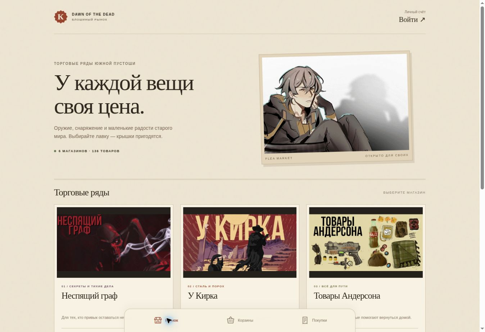

# Блошиный рынок · Dawn of the Dead

Telegram Mini App для **@vfleamarketbot**: шесть магазинов, 136 предметов из утверждённого каталога, отдельные корзины, подтверждение покупки и инвентарь приобретенных предметов и личные квитанции. Оформление — приглушенный скриншот рынка Ривет-Сити из Fallout 3, оливковые плашки и теплые вывески. Генерация изображений не используется. Используются предоставленные изображения и GIF; терминал Протектрона не копируется.



## Что происходит при покупке

1. Telegram передаёт подписанные данные аккаунта. Сервер проверяет HMAC, время и отсутствие дублирующихся полей. Username из клиентского интерфейса не используется для доступа.
2. При первом входе игрок выбирает персонажа и подтверждает, что это его персонаж. **Первичная привязка основана на доверии**, как в существующем контроллере. После привязки другой аккаунт выбрать этого персонажа не сможет. Менять привязку может администрация через лист «Игроки»; бот не предоставляет самостоятельной смены имени.
3. Цены и принадлежность товаров магазину проверяются сервером и отдельно в Apps Script. Недостаточный, пустой, ошибочный или отрицательный баланс блокирует покупку.
4. В таблице «Крышки» **I — накопленная сумма расходов, J — существующая формула остатка**. I увеличивается на сумму покупки, в примечание добавляются дата, магазин и товары. J и начисления не переписываются.
5. Обновление I и неизменяемая квитанция в скрытом листе `_Покупки_бот` сохраняются одним атомарным `Sheets.Spreadsheets.batchUpdate`, под `LockService.getScriptLock`. Telegram ID и скрытый UUID персонажа защищают от путаницы при переименовании и перестановке строк.
6. После атомарного сохранения списания и квитанции касса сразу возвращает результат. Бухгалтерия и личный инвентарь обновляются в фоне: сервер пробуждает обработчик после покупки и повторяет синхронизацию при сбоях. «Заказы» содержит корзину, «Покупки» — позиции, «Сводка» — оборот. Повторное зеркалирование не создаёт дублей и не списывает крышки.

У каждого заказа случайный UUID. До запроса приложение сохраняет номер и корзину в localStorage. При потерянном ответе повторяет тот же заказ; сервер сначала проверяет прежнюю квитанцию, даже если каталог уже обновлён. Кнопки новых покупок временно блокируются до выяснения результата. Неподписанный просмотр каталога не даёт доступа к счетам или покупкам.

## Хранение и администрирование

Финансовый источник истины — исходная Google-таблица со скрытым журналом, а отдельная таблица содержит копию квитанций. Локальная SQLite на постоянном Railway volume хранит только зеркало квитанций и смещение Telegram updates. Потеря SQLite не обнуляет игровые балансы, покупки, привязки или историю.

Не удаляйте скрытые UUID в K и журнал `_Покупки_бот`. Не меняйте вручную I в момент оформления покупки: скриптовая блокировка сериализует роботов, но не ручные правки в Google Sheets. При добавлении нового персонажа администратору нужно задать ему новый UUID в K; имя и тот же UUID следует добавить на лист «Игроки». Если игрок меняет Telegram аккаунт, измените только Telegram ID и Telegram в его строке.

Слоты и эффекты показываются из каталога. Мини-приложение регистрирует приобретение, но не применяет бонусы и не редактирует личные чарки автоматически. Остатки товаров не ограничены: источник не задаёт конечный складской запас. Речь только об игровой валюте; реальные платежи и Telegram Stars не используются.

## Развёртывание

Python 3.12, стандартная библиотека для сервера, Pillow только для подготовки статичных первых кадров GIF. Dockerfile загружает 142 изображения из закреплённого манифеста Drive, проверяет формат и SHA-256, затем включает их в образ. Доступ к Drive посетителям не нужен. Изображения должны оставаться доступны по ссылке для будущих сборок.

Переменные сервера перечислены в `.env.example`. Секреты задаются в Railway, не в репозитории. Обязателен volume `/data`, одна реплика. Публичный HTTPS URL задаётся как `APP_URL`; бот автоматически устанавливает кнопку меню и команды `/start`, `/shop`, `/help`. Существующий webhook этого бота должен быть отключён для long polling.

### Google Apps Script

`google/market.gs` и `google/catalog.gs` добавляются **отдельными файлами** к существующему подписанному мосту Протектрона. В `doPost`, после проверки HMAC и разбора `payload`, добавляется одна строка:

```js
if (String(payload.action).startsWith('market_')) return json_(marketDispatch_(payload));
```

Существующие действия и права остаются прежними. В проекте уже включён расширенный сервис Google Sheets API. Новая версия публикуется в существующее развертывание с сохранением URL. Новый Railway сервис может использовать references `${{protectoron.SHEETS_BRIDGE_URL}}` и `${{protectoron.SHEETS_BRIDGE_SECRET}}` без чтения или копирования значений. Никакие токены не попадают в клиент.

`market_verify` проверяет схему, доступ на запись и версию каталога, изменяя только служебные примечания заголовков. Реальных покупок проверка не создаёт. `/health` сообщает состояние кассы без персональных данных. Каталог цен для моста закреплён в `google/catalog.gs`; несовпадающая версия блокирует новую покупку. После изменения цен выполните `python scripts/build_catalog.py`, обновите оба файла Apps Script и опубликуйте новую версию. Дополнительных разрешений на внешние запросы мост не требует.

## Проверка первой привязки

На листе «Игроки» мастер заполняет Telegram username в столбце C напротив персонажа. При первом входе сервер сверяет его с username из проверенных подписанных данных Telegram, без учета регистра и начального @. Игроку возвращается только его доступный персонаж. В запросе привязки проверка повторяется под общей блокировкой, поэтому подмена ID персонажа в браузере не дает доступа к чужому балансу.

После привязки основным идентификатором становится Telegram ID. Смена username не отключает уже привязанный аккаунт и не передает его персонажа новому владельцу старого username. Пустое или неоднозначное соответствие запрещает новую привязку; мастер исправляет его в таблице. Вход повторно читает таблицу, отдельной синхронизации списка не требуется. Существующие привязки по ID сохраняются.

## Проверки

```sh
python scripts/download_assets.py
python -m unittest discover -s tests -p 'test_*.py' -v
node tests/bridge.cjs
node tests/entry.cjs
node tests/inventory.cjs
node tests/backpacks.cjs
node --check public/app.js
node --check public/backpack.js
```

Финансовые тесты выполняют реальный `google/market.gs` с изолированной моделью Google Sheets. Проверяются двойное нажатие, потеря ответа после успешного списания, недоступная бухгалтерия, повторная синхронизация, нехватка крышек, подмена цен, чужой аккаунт, смешанные магазины, повторный номер с другой корзиной, смена каталога и защита формул. Балансы настоящих игроков в тестах не используются.

## Бункерное оформление и инвентарь

Оливковая палитра применяется к магазинам и выбору персонажа. На ПК окна открываются по центру, действия и надписи кнопок выровнены по обеим осям. Фон — исходный игровой скриншот, источники и контрольные суммы в `docs/asset-sources.json`.

«Инвентарь» объединяет покупки из полного журнала с вручную записанными вещами персонажа. Покупки зеркалируются в личный лист общей сводки. Игрок выбирает состав рюкзака; сервер проверяет принадлежность вещей, актуальную вместимость и версию набора перед записью в таблицу ветки. Если листа нет в общей сводке, приложение просит дождаться листа. Если в этой главе персонаж уже есть в другой ветке, создание и сохранение чужого рюкзака запрещены с сообщением «Выберите корректную ветку». Для ещё не распределённого персонажа сохраняется перенос его собственных характеристик из общей сводки.

Чтение инвентаря не выполняет запись и не ждёт блокировку кассы. Текст, заметки и формулы ячеек читаются пакетно. Кнопка рюкзака использует PNG Standard backpack из Fallout 76 ([источник](https://fallout.fandom.com/wiki/Backpack_(Fallout_76))); рядом находится обновление. Цветные браузерные обводки при касании убраны; для клавиатуры оставлен спокойный индикатор фокуса.
